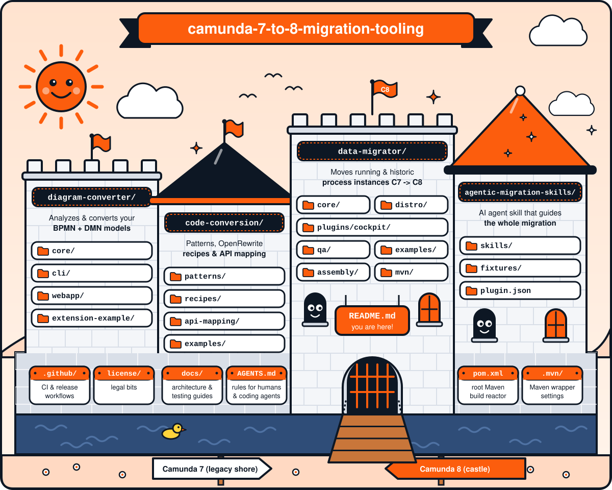

# Camunda 7 to 8 Migration Tooling

This repository contains a collection of tools to help you migrate from Camunda 7 to Camunda 8.



## CI Status


| Branch           | CI Status |
|------------------|-----------|
| **main**         | [](https://github.com/camunda/camunda-7-to-8-migration-tooling/actions/workflows/ci.yml?query=branch%3Amain) |
| **maintenance/8.10** | [](https://github.com/camunda/camunda-7-to-8-migration-tooling/actions/workflows/ci.yml?query=branch%3Amaintenance%2F8.10) |
| **maintenance/0.3** | [](https://github.com/camunda/camunda-7-to-8-migration-tooling/actions/workflows/ci.yml?query=branch%3Amaintenance%2F0.3) |
| **maintenance/0.2** | [](https://github.com/camunda/camunda-7-to-8-migration-tooling/actions/workflows/ci.yml?query=branch%3Amaintenance%2F0.2) |

## Available Tools

### [Data Migrator](./data-migrator/)
A tool for migrating Camunda 7 process instances and related data to Camunda 8. This migrator helps organizations seamlessly transition their process instances while preserving execution state and variables ensuring minimal disruption to ongoing business processes.

Please see the official documentation for more details: [Camunda 7 to 8 Migration Guide](https://docs.camunda.io/docs/next/guides/migrating-from-camunda-7/migration-tooling/data-migrator/).
                                                                                         

### [Diagram Converter](./diagram-converter/)
A tool for analyzing and converting Camunda 7 models (BPMN & DMN) to Camunda 8 format. The Diagram Converter identifies migration tasks and automatically converts process models, with support for custom extensions to accommodate special requirements.

For detailed information, see the [Diagram Converter README](./diagram-converter/README.md).

### [Code Conversion](./code-conversion/)
A comprehensive toolkit for converting Camunda 7 code to Camunda 8. This module provides:

- **[Code Conversion Patterns](./code-conversion/patterns/)** - Best practices and patterns for migrating Java (Spring) client code and glue code
- **[OpenRewrite Recipes](./code-conversion/recipes/)** - Automated refactoring recipes to streamline Java code migration
- **[API Mapping WebApp](https://camunda.github.io/camunda-7-to-8-migration-tooling/)** - Interactive tool showing how Camunda 7 API endpoints map to Camunda 8

For detailed information, see the [Code Conversion README](./code-conversion/README.md).

### [AI Agent Skill](./agentic-migration-skills/)

An [Agent Skill](https://agentskills.io/) that guides you through the full migration interactively — no copy-pasting prompts from docs. Works with any [Agent Skills](https://agentskills.io/)-compatible AI coding agent, including [AWS Transform custom](./agentic-migration-skills/README.md#aws-transform-custom).

**Install with Claude Code:**

```bash
claude plugin marketplace add camunda/camunda-7-to-8-migration-tooling
claude plugin install camunda-migration
```

**Install with GitHub Copilot CLI:**

```bash
copilot plugin marketplace add camunda/camunda-7-to-8-migration-tooling
copilot plugin install camunda-migration@camunda-migration
```

**Install with any other agent** (Cursor, Codex, Gemini CLI, Cline, Windsurf, and [25+ more](./agentic-migration-skills/README.md)) via [GitHub CLI](https://cli.github.com/) 2.90+:

```bash
gh skill install camunda/camunda-7-to-8-migration-tooling migrate-c7-to-c8-code --agent <your-agent>
```

**Use** (from your project directory):

```
/camunda-migration:migrate-c7-to-c8-code
```

After checking model suitability, the skill will ask for your project path and walk you through three
code paths:

| Approach | What it does |
|----------|-------------|
| **AI only (AI-first)** *(recommended with a capable coding model)* | Applies migration patterns directly to the source. Use it for semantic, mixed, or complex Java code. Review every change. |
| **OpenRewrite + AI** | Runs recipes for repeated, supported syntax transformations, then AI cleans and reviews the generated code. Expect scaffolding, TODOs, and cleanup. |
| **Assessment only** | Scans the codebase and reports files, complexity, and effort estimate — no changes made |

Compare the code paths on representative classes when practical. Recipes help with repeated,
well-supported syntactic changes. They can hurt by adding cleanup for semantic or mixed
delegate/client code.
They do not decide domain behavior, eventual consistency, transaction boundaries, or architecture.
Both migration paths need review and validation.

The skill fetches the latest [pattern catalog](./code-conversion/patterns/ALL_IN_ONE.md) at runtime, so it always reflects current migration guidance.

When activated, the skill recommends a model intended for complex reasoning (for example `claude-sonnet-*`, `claude-opus-*`, or `gpt-5.6-luna`), and asks before proceeding with a lightweight or unverifiable model. These are routing hints, not a benchmark.


## Documentation

- **[Camunda 7 to 8 Migration Guide](https://docs.camunda.io/docs/guides/migrating-from-camunda-7/)** - Official migration documentation
- **[Data Migrator Documentation](./data-migrator/README.md)** - Detailed data migrator documentation
- **[Diagram Converter Documentation](./diagram-converter/README.md)** - Model analysis and conversion tools
- **[Code Conversion Documentation](./code-conversion/README.md)** - Code conversion patterns and tools
- **[Camunda 8 Documentation](https://docs.camunda.io/)** - Official Camunda 8 documentation

## Contributing

We welcome contributions to the Camunda 7 to 8 Migration Tooling! Here's how you can help:

### Ways to Contribute

1. **Report bugs** - Create detailed issue reports
2. **Suggest features** - Propose new functionality
3. **Submit code** - Fix bugs or implement features
4. **Improve documentation** - Help others understand the tool
5. **Test and provide feedback** - Try the tool and share your experience

See our [issue tracker](https://github.com/camunda/camunda-7-to-8-migration-tooling/issues/).

### Before Contributing

1. **Read the [Contributions Guide](https://github.com/camunda/camunda-bpm-platform/blob/master/CONTRIBUTING.md)**
2. **Check existing issues** to avoid duplicates [link](https://github.com/camunda/camunda-7-to-8-migration-tooling/issues/)
3. **Discuss major changes** in an issue before implementing

### Development Guidelines

- **Follow Java coding standards** and existing code style
- **Write tests** for new functionality
- **Update documentation** when adding features
- **Use meaningful commit messages**
- **Keep changes focused** - one feature/fix per pull request

### License Headers

Every source file must contain the license header. See [license header template](./license/header.txt) for the exact format required.

### Pull Request Process

1. Fork the repository
2. Create a feature branch from `main`
3. Make your changes with tests
4. Ensure all tests pass
5. Update documentation if needed
6. Submit a pull request with a clear description

## Releasing

The `Release` GitHub Actions workflow is the supported way to publish release artifacts. For a
full release, always create a `release/<version>` branch from the maintenance branch for the
release line, then run the workflow from the release branch.

### Full release

1. Before branching, confirm the maintenance branch is up to date and its CI is green. The release workflow skips tests, so run CI on the release branch too if you add any release-specific changes. Check the Camunda dependency versions in the root `pom.xml` (`version.camunda-7`, `version.camunda-8`, and `version.camunda-8.previous`) and confirm they are the intended current versions for this release line.
2. Create the release branch from the maintenance branch:

   ```bash
   git fetch origin
   git switch -c release/<version> origin/maintenance/<line>
   git push -u origin release/<version>
   ```

3. In **Actions > Release**, run the workflow from `release/<version>`. Set the inputs as follows for a full release:

   | Input | Value | Notes |
   | --- | --- | --- |
   | `RELEASE_VERSION` | `<version>` | Version to release and tag, for example `0.3.0`; use the same version as the branch name. |
   | `DEVELOPMENT_VERSION` | `<next-version>-SNAPSHOT` | Next development version to set in the Maven project files after tagging. |
   | `IS_DRY_RUN` | `false` | Required for a real release; the workflow default is `true`. |
   | `ONLY_PUSH_TO_MAVEN_CENTRAL` | `false` | Set to `true` only for the Maven Central backfill procedure below. |
   | `ONLY_PUBLISH_DOCKER_IMAGE` | `false` | Set to `true` only to publish an image from an earlier release workflow run. |
   | `SOURCE_RELEASE_RUN_ID` | Leave empty | Required only when `ONLY_PUBLISH_DOCKER_IMAGE` is `true`. |
   | `DEPLOY_DIAGRAM_CONVERTER` | `false` | Set to `true` only when this release should also deploy the Diagram Converter to production. |

   Do not enable every option. The `ONLY_*` inputs select separate recovery paths, and
   `DEPLOY_DIAGRAM_CONVERTER` triggers an additional deployment.
4. The Maven Release job changes the Maven project files to `RELEASE_VERSION`, creates and pushes a Git tag with that version, then changes the project files to `DEVELOPMENT_VERSION` and pushes that commit to the release branch. Do not create the tag manually.
5. The `Maven Release` job publishes artifacts to the configured Camunda repository and automatically publishes the validated Sonatype Central deployment. It waits for Maven Central artifacts to become available and verifies them; no manual **Publish** step in the Central UI is needed.
6. After Maven Central verification, the `Publish GitHub Release Assets` job creates a draft GitHub Release with generated notes, uploads and verifies these release assets, then publishes the release:
   - Data Migrator `.tar.gz` and `.zip` distributions
   - Data Migrator Cockpit plugin `.jar`
   - Code Conversion recipes `.jar`
   - Diagram Converter core, webapp, and CLI `.jar` files

   The `Build and Publish Docker Image` job also publishes the Data Migrator Docker image. The optional `Deploy Diagram Converter` job runs only when `DEPLOY_DIAGRAM_CONVERTER` is `true`. If an expected GitHub release asset is missing or differs from the built artifact, the job fails and a newly created release remains a draft. A failed asset-publishing job can be rerun safely; it uploads only missing assets and refuses to overwrite a file with a different digest.
7. After the workflow succeeds, open a pull request from `release/<version>` back to the maintenance branch it was created from. Merge it so the release commit and the next `-SNAPSHOT` version are present on the maintenance branch.

### Backfill Maven Central for an existing tag

If a GitHub release/tag already exists but Maven Central is missing the artifacts, use this
recovery path instead of running a full release. Rerun the `Release` workflow with:

- `RELEASE_VERSION=<existing-tag>`
- `DEVELOPMENT_VERSION=<next-version>-SNAPSHOT` (required workflow input; ignored in backfill mode)
- `IS_DRY_RUN=false`
- `ONLY_PUSH_TO_MAVEN_CENTRAL=true`

Run the workflow from the current `main` branch so it uses the fixed publication workflow, not the old workflow definition stored in the release tag. This mode skips `release:prepare`, checks out the release tag, rebuilds the artifacts from that source, and publishes them to Maven Central only.
It performs the same publication verification and fails if any expected artifact is still unavailable after the Central propagation timeout. It does not create, modify, or publish GitHub Release assets.

## License

The source files in this repository are made available under the [Camunda License Version 1.0](./CAMUNDA-LICENSE-1.0.txt).

---

## Additional Resources

- **[Camunda 8 Documentation](https://docs.camunda.io/)** - Official Camunda 8 documentation
- **[Migration Analyzer & Diagram Converter](https://diagram-converter.camunda.io/)** - Tool for migrating BPMN models and analyzing migration effort
- **[Community Forum](https://forum.camunda.io/)** - Get help from the community
- **[GitHub Issues](https://github.com/camunda/camunda-7-to-8-migration-tooling/issues)** - Report bugs and request features in the issue tracker
